<h3><code>zneb21@github ~ $ ./contributions.sh</code></h3>

  

<h3><code>zneb21@github ~ $ whoami</code></h3>

<table>
<tr>
<td valign="top"></td>
<td valign="top"></td>
</tr>
</table>

  

<h3><code>zneb21@github ~ $ stack --list</code></h3>

  
  
  
  
  
  
  
  

<h3><code>zneb21@github ~ $ ./links.sh</code></h3>

<b>Full-Stack Web Developer · Data Scientist · ML Engineer</b>

 

Building useful software, exploring data, and learning in public.

